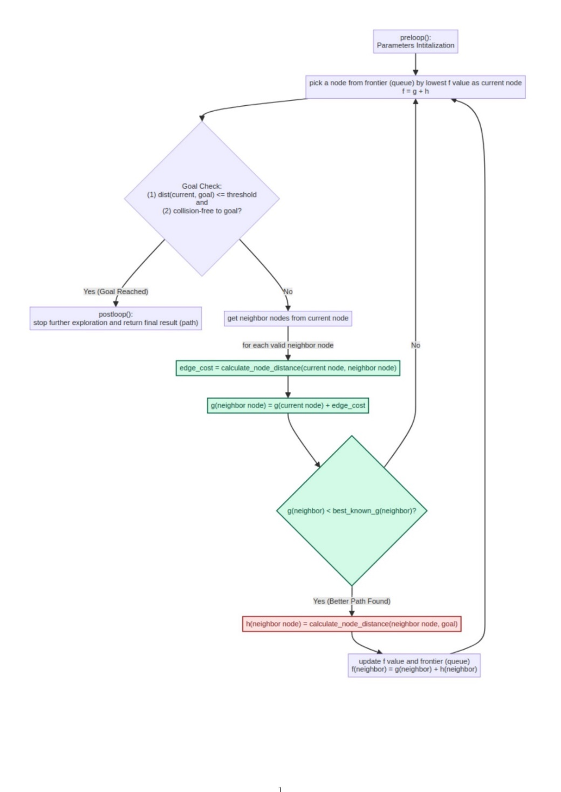
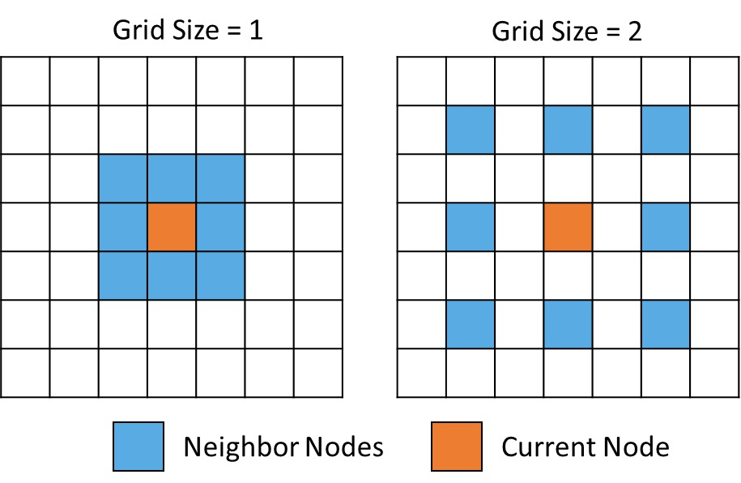
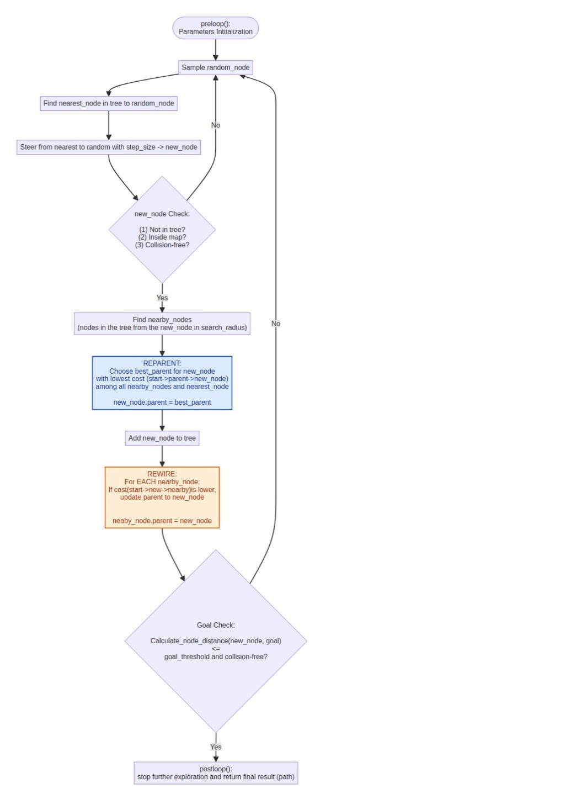
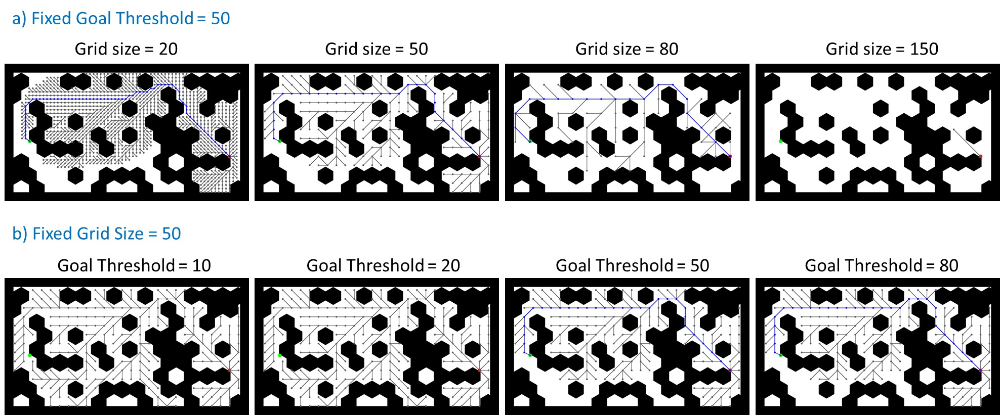
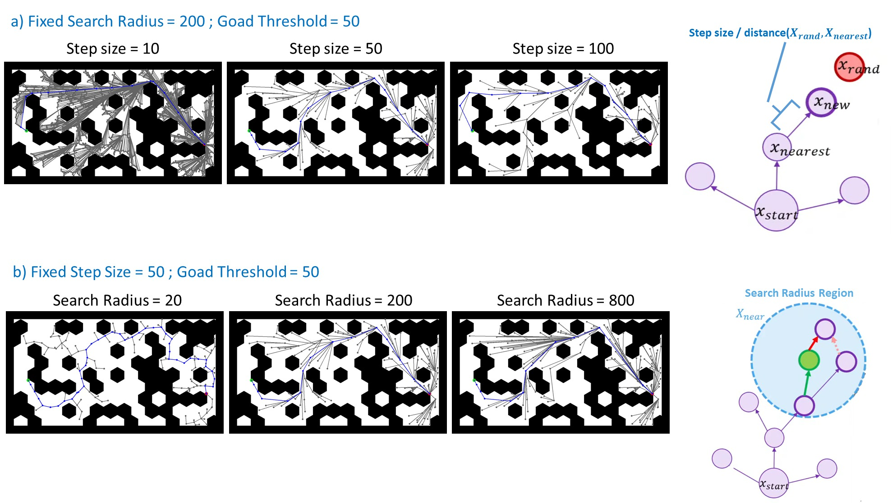

# rne-path-planning

Implementation and comparison of two classic path-planning algorithms — **A\*** and **RRT\*** — for a mobile robot navigating a 2D occupancy-grid map. Built for the "Robotic Navigation and Exploration" course (NTHU).

> The original project description (written by the course instructor) is not included here for copyright reasons. It can be found here: [Project description](https://drive.google.com/file/d/1bObcmjATzILIYTRYSehswC8Mk8u_771h/view?usp=sharing).

> My own written report: [report](https://drive.google.com/file/d/1Kkiq612zTogstmp2J6x_DHOuK4sJ8oaB/view?usp=drive_link).

## Structure

```
path_planning/          # Provided planner framework (A*, RRT*, shared primitives/utils)
your_implementation/    # My implementation of the A* and RRT* search logic
docs/                   # Flowcharts and parameter-comparison figures from my report
main.py                 # Entry point
```

## What this implements

**A\*** combines Dijkstra's accumulated cost `g(v)` with a heuristic estimate `h(v)` of the remaining distance to the goal, searching in priority order of `f(v) = g(v) + h(v)` over the 8-connected neighbors of a grid. The search keeps updating a neighbor's parent/cost whenever a cheaper path is found, until a node within the goal threshold and collision-free is reached.



A larger grid size means fewer, more widely spaced neighbor candidates per step:



**RRT\*** builds a tree by randomly sampling points and connecting each new node to its nearest neighbor, then improves on plain RRT with two key steps:
- **Reparent** — when adding a new node, pick the nearby node that gives the lowest-cost path from the start, not just the nearest one.
- **Rewire** — after insertion, check whether routing nearby nodes through the new node would lower their cost, and reconnect them if so.

These two steps let RRT* keep improving the tree as sampling continues, converging toward a near-optimal path instead of just *a* path.



## Results / what I found

- **A\* — grid size**: a larger grid spaces out nodes (sparser), which speeds up search but loses path precision; a smaller grid gives a finer path at a much higher computational cost.
- **A\* — goal threshold**: setting the threshold too small makes the "reached goal" condition overly strict — the search can get arbitrarily close to the goal and still fail to terminate, either reporting no path or continuing to explore unnecessarily.



- **RRT\* — step size**: a larger step size spreads samples out (faster expansion, lower resolution); a smaller step size searches more finely but is much more expensive.
- **RRT\* — search radius**: this controls how far reparent/rewire can reach (the region shown below). A larger radius lets nodes connect to farther neighbors, producing straighter paths; a smaller radius limits connections and tends to produce more winding paths.



See `Results/` for the full set of rendered paths across these parameter sweeps (grid size, goal threshold, RRT* radius/step size) on the test map.
